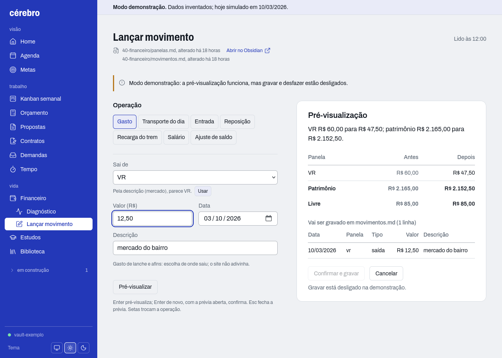
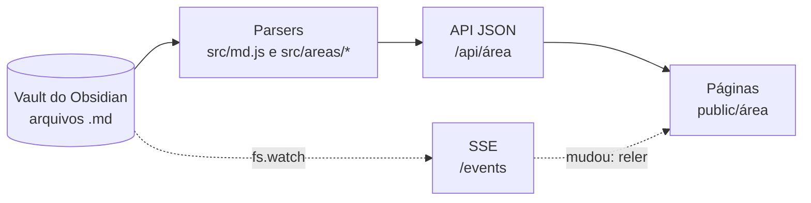

# cérebro

[English](README.en.md)

Site local que mostra em páginas e gráficos o que está nas minhas notas do Obsidian: agenda, kanban da semana, finanças, estudos, metas, orçamento, propostas e contratos. O vault é a fonte da verdade e o site só lê, com uma única exceção, a página Lançar movimento do financeiro: quem registra é o terminal, o Obsidian ou essa página, e as páginas refletem. Existe para eu ver o estado do dia sem abrir dez arquivos.

**Sem IA em tempo de execução. Sem banco de dados. Atualização ao vivo.**

## Capturas

Modo demonstração (`npm run demo`): vault de exemplo, dados inventados, data fixa em 10/03/2026. Claro à esquerda, escuro à direita.

| Claro | Escuro |
|---|---|
|  |  |
|  |  |
|  |  |
|  |  |
|  |  |
|  |  |
|  |  |
|  |  |
|  |  |
|  |  |
|  |  |
|  |  |
|  |  |
|  |  |
|  |  |

No celular (500px de largura): Home no tema escuro e o menu aberto no tema claro.

| Home | Menu aberto |
|---|---|
|  |  |

Lançar movimento (a única página que escreve), na demo, com a pré-visualização aberta (na demo gravar fica desligado):



### Regerar as capturas

```sh
npm run capturas
```

Precisa do Firefox no PATH (ou `FIREFOX=/caminho npm run capturas`) e não tem dependências do npm: o script `scripts/capturas.js` fala Marionette com o Firefox pelo `node:net`. Ele sobe o `npm run demo` se a porta 3738 estiver livre (e recusa um servidor que não seja a demo), abre o Firefox sem interface com um perfil temporário (nada do seu perfil), com `prefers-reduced-motion` e fuso de São Paulo, e apaga os PNGs de `docs/capturas/` antes de gravar os novos. Para a imagem sair sempre igual:

- um proxy local congela o relógio do navegador em 10/03/2026 12:00 ("Lido às 12:00");
- as datas de modificação do vault de exemplo ficam em 09/03/2026 durante a captura e voltam ao normal no fim ("alterado há 18 horas");
- cada tela espera fontes, menu, origem da página e dados carregarem, e o DOM parar de mudar;
- antes de cada imagem confere a faixa "Modo demonstração" e o vault `vault-exemplo`; se vir outra coisa, aborta.

Orçamento, Propostas e Contratos são preenchidos com cliques e teclas (Contratos com a proposta aceita escolhida e "sistema sob medida" e "trata dados pessoais" marcados). Para regerar só algumas telas, passe o nome-base: `npm run capturas -- metas home` (as outras imagens ficam como estão). Para mudar as telas, edite a lista `TELAS` no começo da parte "as telas" do script. Limitação: sem o pacote de idioma pt-BR no Firefox, os campos de data aparecem como mm/dd/aaaa.

## Áreas

| Rota | O que faz | Lê do vault |
|---|---|---|
| `/` | Data, frase do dia, faixa da semana, o que pede atenção e o que está em andamento | o resumo e as datas de cada área |
| `/agenda` | Próximos 14 dias e grade do mês, juntando compromissos, prazos do kanban e datas do financeiro | `10-diario/agenda.md`, `10-diario/kanban-AAAA-SS.md` |
| `/kanban` | Quadro da semana ISO, com prazo, atraso e filtro por projeto | `10-diario/kanban-AAAA-SS.md` |
| `/financeiro` | Patrimônio, metas, saldo por panela, saídas por dia, últimos movimentos | `40-financeiro/panelas.md`, `40-financeiro/movimentos.md` |
| `/financeiro/lancar` | **A única página que escreve.** Lança gasto, transporte do dia, entrada, reposição, recarga do trem, salário e ajuste de saldo, com pré-visualização, confirmação e desfazer | `40-financeiro/panelas.md`, `40-financeiro/movimentos.md` (lê e grava), `config.json` |
| `/financeiro/diagnostico` | Semáforo de metas, orçamento livre, VR e dia a dia, com "o que fazer" | os dois acima e `config.json` |
| `/estudos` | Progresso dos roadmaps, próximos passos, revisões pendentes | `60-estudos/*.md` (tag `roadmap`), `20-biblioteca/` |
| `/metas` | Metas por área (carreira, estudos, dinheiro, negócio, pessoal) com barra, prazo, status e ritmo necessário; as do financeiro e dos roadmaps entram sozinhas | `10-diario/metas.md`, `40-financeiro/panelas.md`, `60-estudos/*.md` |
| `/tempo` | Cronômetro e pomodoro, horas por projeto na semana e no mês, dias com registro, maiores projetos e últimos registros | `80-tempo/AAAA-MM.md` |
| `/biblioteca` | Lista e busca das notas de `20-biblioteca` por pasta e status, com a revisão pendente primeiro, e dos livros de um segundo vault do Obsidian (opcional), com link para abrir no Obsidian | `20-biblioteca/**/*.md`, pasta de livros em `config.local.json` |
| `/relatorios` | A semana ou o mês, navegáveis: tempo por projeto, gastos por categoria (cada um comparado ao período anterior) e a situação das metas; "Copiar resumo" gera o texto | `80-tempo/`, `40-financeiro/`, `10-diario/metas.md`, `60-estudos/` |
| `/demandas` | O que está em andamento por cliente: projetos (com o backlog em aberto), propostas e contratos, ordenados pelo prazo mais próximo | `30-projetos/*.md`, `70-negocio/propostas`, `70-negocio/contratos`, `70-negocio/clientes` |
| `/orcamento` | Calculadora: valor recomendado, piso, entrada e composição | `70-negocio/precificacao.md` |
| `/propostas` | Gera o documento da proposta para copiar, baixar ou imprimir | `70-negocio/perfil.md`, `70-negocio/modelos/proposta.md`, `70-negocio/precificacao.md` |
| `/contratos` | Gera o contrato a partir de uma proposta aceita, com Anexo I, para copiar, baixar ou imprimir | `70-negocio/modelos/contrato.md`, `70-negocio/propostas/*.md` (status aceita), `70-negocio/perfil.md`, `70-negocio/precificacao.md` |

Detalhe de cada área em [`docs/referencia.md`](docs/referencia.md).

## Arquitetura



O servidor Node lê os arquivos Markdown do vault a cada requisição, sem cache e sem banco, e transforma tabelas, frontmatter e checkboxes em JSON. Cada área tem seu parser e sua rota `/api/<área>`. As páginas são HTML e JavaScript estáticos que consomem essa API. Um `fs.watch` observa as pastas de cada área; quando um `.md` muda, o servidor avisa as páginas abertas por Server-Sent Events e elas pedem a API de novo. Não há rota que escreva: o vault pode ser editado por qualquer ferramenta sem risco de o site sobrescrever algo, e o site nunca é a fonte de um número.

## Como rodar

Requisitos: Node 20 ou mais novo.

```sh
npm install
npm start          # http://127.0.0.1:3737, lê $HOME/cerebro
npm run demo       # http://127.0.0.1:3738, vault de exemplo (dados inventados)
npm test
```

Configuração:

- **Caminho do vault:** `CEREBRO_VAULT=/caminho npm start` ou `npm start -- --vault=/caminho`. Outra porta: `--porta=<n>`. A demo ignora `CEREBRO_VAULT`, então nunca mostra o vault real.
- **`config.json`:** premissas do diagnóstico (transporte por dia, categorias por palavra-chave, janelas, limites do semáforo) e o modo demo. É lido a cada requisição.
- **`config.local.json`** (opcional, **ignorado pelo git**): o que é só seu e se sobrepõe ao `config.json`, por exemplo palavras-chave de categoria e metas padrão. Objetos se mesclam chave a chave; uma lista ou valor simples troca o do `config.json` por inteiro. Não vale no modo demo nem nos testes, para os dados inventados e os testes ficarem iguais em qualquer máquina.
- **`nav.json`:** grupos e itens do menu. Item cuja área está registrada em `src/areas/index.js` fica ativo sozinho; o resto aparece como "em construção".

## Lançar movimento (a única escrita)

`/financeiro/lancar` (botão "Lançar" no Financeiro) grava lançamentos do dia a dia em `40-financeiro/panelas.md` e `movimentos.md`. As regras e os formatos são os da skill `financeiro` do vault, a fonte única; o código as aplica em `src/areas/financeiro/lancar.js`, um motor **puro** (recebe os textos e devolve os textos novos, sem tocar em disco). Quem escreve é `lancar-io.js`.

**Operações:** gasto (do VR, do débito/VT, de outra panela direto, ou pago da conta com reposição de Pessoal, Margem, Reserva ou da panela das metas), transporte do dia (R$ 5,00 no VT e R$ 5,50 no trem; sábado R$ 10,00 e R$ 5,50; domingo bloqueado), entrada, reposição (panela para a Conta, em dois modos: **quitar pendências**, só as que você marca, uma a uma, com o valor igual à soma; ou **transferência livre**, um adiantamento que não quita nada; o site nunca quita por ordem de data), recarga do cartão do trem, salário (dividido pela regra de `panelas.md`, 71/0/20/9 se a reserva já bateu a meta) e ajuste de saldo (você informa o saldo real; grava a diferença como "Ajuste p/ bater com o Inter").

**Como se usa:** escolha a operação, preencha, Enter. A pré-visualização mostra saldo antes e depois por panela, patrimônio e livre, e as linhas que serão gravadas. Enter de novo (ou "Confirmar e gravar") grava; o foco volta ao valor. "Desfazer" devolve os dois arquivos ao que eram. Saldo que ficaria negativo, VT acima da Conta ou reposição da reserva ou da panela das metas exigem marcar "Li os avisos".

**Salvaguardas** (todas testadas):

- **Pré-escrita:** valor maior que zero com até 2 casas (vírgula vale; nos campos Valor e Saldo real a máscara põe a vírgula sozinha: `1250` vira `12,50`), descrição sem quebra de linha e com `|` trocado por `/`, data válida e não futura. A verificação em memória roda `parsePanelas` e `parseMovimentos` nos textos novos e **aborta sem gravar** se surgir aviso novo, se um saldo não ficar como calculado, se a soma dos saldos (sem o VT) não bater com o patrimônio escrito ou se o histórico antigo fosse alterado.
- **Quem pode chamar:** só `127.0.0.1` com `Host` permitido, `Sec-Fetch-Site`/`Origin` do mesmo site e o token de sessão no cabeçalho `X-Cerebro-Token`, que a página pega em `GET /api/sessao` (sem CORS). Corpo JSON validado por esquema, até 4 KB.
- **Versão:** o corpo traz o hash dos dois arquivos lido com a página. Se mudaram (Obsidian, skill, outro lançamento), 409 e a página relê e pede para refazer.
- **Duplo clique:** o mesmo payload em 30 s dá 409.
- **Gravação:** arquivo temporário e `rename`, `movimentos.md` primeiro e `panelas.md` depois; se a segunda falhar, a primeira é restaurada.
- **Desfazer:** só o último lançamento feito pelo site, e só se os arquivos não mudaram depois dele. Sobrevive ao reinício do serviço (o texto de antes vem do git do vault).
- **Git do vault:** se o vault é um repositório git, cada lançamento e cada desfazer viram um commit só de `panelas.md` e `movimentos.md` (sem push, sem tocar nos outros arquivos); o que já estava sem commit nesses dois arquivos ganha antes um commit à parte. Desligável em `config.json`.
- **Demo:** só a pré-visualização funciona; gravar e desfazer devolvem 403 com mensagem e a página avisa.

**Rotas:** `GET /api/sessao`, `GET /api/financeiro/lancar` (contexto da página) e `POST /api/financeiro/previa`, `/lancar`, `/desfazer`. Detalhes em [`docs/referencia.md`](docs/referencia.md#lançar-movimento-financeirolancar).

### Ensaio antes de usar no vault real

```sh
node scripts/ensaio.js --vault=~/cerebro
npm start -- --vault=/tmp/cerebro-ensaio --porta=3739
```

`scripts/ensaio.js` copia só `40-financeiro/` do vault apontado para `/tmp/cerebro-ensaio` (o vault real é apenas lido) e imprime o comando acima. Abra `http://127.0.0.1:3739/financeiro/lancar`, lance, desfaça, e confira os arquivos da cópia. Rodar o script de novo recomeça do zero.

Roteiro automatizado no navegador (Reposição nos dois modos, Salário e Desfazer), sobre uma cópia temporária do vault de exemplo, com conferência por contas próprias e do sha256 do vault real:

```sh
node scripts/teste-lancar-ui.js     # precisa do Firefox; fora do npm test
```

### Backup do vault

```sh
node scripts/backup.js              # copia o vault para ~/Backups/cerebro/cerebro-AAAA-MM-DD-HHMM.tar.zst
systemctl --user enable --now cerebro-backup.timer   # todos os dias às 21:30 (arquivos em docs/referencia.md)
```

Destinos, retenção e criptografia (`gpg`) em `config.json → backup` (o seu, em `config.local.json`, por exemplo um disco externo). A Home avisa se o backup atrasa. Detalhes em [`docs/referencia.md`](docs/referencia.md#backup-do-vault).

### Como serviço do usuário (systemd)

Para o site subir sozinho na porta 3737, crie `~/.config/systemd/user/cerebro-site.service`:

```ini
[Unit]
Description=cerebro-site
After=default.target

[Service]
Type=simple
WorkingDirectory=/caminho/do/cerebro-site
ExecStart=/caminho/do/node /caminho/do/cerebro-site/server.js --porta=3737
Restart=on-failure
RestartSec=3
NoNewPrivileges=yes

[Install]
WantedBy=default.target
```

Use `command -v node` para o caminho do Node. O vault é `$HOME/cerebro` (ou `Environment=CEREBRO_VAULT=...` na unidade). Depois:

```sh
systemctl --user daemon-reload
systemctl --user enable --now cerebro-site     # ativar e iniciar agora
journalctl --user -u cerebro-site -f           # ver os logs
systemctl --user status cerebro-site           # estado
systemctl --user restart cerebro-site          # depois de mudar o código
systemctl --user disable --now cerebro-site    # parar e não subir mais
```

Para o serviço rodar sem você estar logado: `loginctl enable-linger $USER`.

## Formatos dos arquivos

Exemplos curtos, com dados inventados. Colunas de tabela são lidas pelo nome; colunas extras são ignoradas.

**`10-diario/agenda.md`**

```markdown
| data | início | fim | título | tipo | obs |
| --- | --- | --- | --- | --- | --- |
| 2026-03-10 | 19:00 | 22:00 | Aula de Redes | aula | laboratório 3 |
| 2026-03-11 |  |  | Prova de Redes | prova | levar calculadora |
```

**`10-diario/metas.md`** (opcional; sem ele, só as metas automáticas)

```markdown
| meta | area | alvo | atual | unidade | inicio | prazo | obs |
| --- | --- | --- | --- | --- | --- | --- | --- |
| Publicar artigos | carreira | 10 | 3 | artigos | 2026-03-01 | 2026-03-31 | |
| Quitar o cartão | dinheiro | 500 | 200 | R$ | | | sem prazo, só a barra |
```

`area` é carreira, estudos, dinheiro, negocio ou pessoal. `inicio` e `prazo` vêm juntos ou ficam os dois vazios. Linha inválida vira aviso na página e não entra na conta.

**`10-diario/kanban-2026-11.md`** (compatível com o plugin Kanban)

```markdown
---
kanban-plugin: board
---

## A fazer

- [ ] Revisar sub-redes para a prova @2026-03-11 #faculdade

## Feito

- [x] Montar o kanban da semana #cerebro-site
```

**`40-financeiro/panelas.md`** (os saldos aqui são a fonte da verdade e nunca são recalculados)

```markdown
## Saldos atuais (em 2026-03-10)

| panela | id | saldo | obs |
| --- | --- | --- | --- |
| Reserva | reserva | 300.00 | |
| Pessoal / Lazer | pessoal | 40.00 | |

Patrimônio total: 340.00.
```

**`40-financeiro/movimentos.md`**

```markdown
| data | panela | tipo | valor | descrição | obs |
| --- | --- | --- | --- | --- | --- |
| 2026-03-09 | pessoal | saída | 14.00 | almoço |  |
| 2026-03-01 | reserva | entrada | 200.00 | Divisão do salário |  |
```

**`70-negocio/precificacao.md`**

```markdown
## Parâmetros

| chave | valor | unidade | descrição |
| --- | --- | --- | --- |
| valor_hora | 50 | R$/h | Valor/hora alvo |
| margem_risco | 0.10 | fração | Margem de risco |
| entrada | 0.40 | fração do recomendado | Entrada |
| imposto | a definir | fração do bruto | Imposto |
```

Valor "a definir" ou ausente vira aviso na página e desativa só o cálculo que depende dele. Nada é chutado.

**`70-negocio/propostas/site-institucional.md`** (só as de `status: aceita` aparecem em `/contratos`)

```markdown
---
status: aceita
cliente: Loja Exemplo Ltda
projeto: Site institucional
valor: 2500
entrada_percentual: 0.4
inicio: 2026-03-16
entrega: 2026-04-13
escopo:
  - Três páginas: início, serviços e contato
  - Formulário de contato
fora_do_escopo: [Redação dos textos, Loja virtual]
entregaveis: [Código-fonte, Manual curto de uso]
---
```

**`70-negocio/modelos/proposta.md`**

```markdown
# Proposta: {{projeto}}

Para: {{cliente}}
Válida até: {{validade_data}}

## Escopo
{{escopo}}

## Investimento
Valor total: **{{valor_total}}**
Entrada ({{entrada_percentual}}): {{entrada_valor}}
```

Linha com campo vazio ou desconhecido some do documento, e seção que ficou sem nada também.

**`70-negocio/modelos/contrato.md`** usa o mesmo motor e acrescenta blocos `{{#se campo}}` ... `{{/se}}`
(marcas em linha própria, sem aninhamento). Linhas de citação (`>`) e o que vem antes do primeiro título ficam fora do documento.

```markdown
> Nota para quem edita o modelo: não entra no documento.

# Contrato de prestação de serviços
{{#se minuta}}
**MINUTA: ainda não revisada por advogado.**
{{/se}}

## Partes
**Contratante:** {{contratante_nome}}
{{contratante_documento_tipo}}: {{contratante_documento}}
Representante legal: {{contratante_representante}}

{{#se trata_dados}}
## Dados pessoais
O sistema trata dados pessoais: {{dados_tratados}}
{{/se}}
```

## Decisões de projeto

- **Quase só leitura.** O vault continua sendo a única fonte. O site escreve só onde a rotina pede formulário: Lançar movimento (`/financeiro/lancar`, em `40-financeiro/panelas.md` e `movimentos.md`, pelas regras da skill `financeiro`), registrar tempo (`80-tempo`), pôr compromisso na agenda e criar/mover card do kanban, os três com as mesmas salvaguardas (token, origem, versão, gravação atômica, verificação, commit git só do arquivo). Detalhes em `docs/referencia.md`.
- **Regras determinísticas.** O diagnóstico e a calculadora usam regras fixas e premissas em `config.json`, para que o mesmo vault dê sempre o mesmo veredito e cada número possa ser explicado ("Como calculei").
- **Dado ausente vira aviso, não valor.** "A definir" não entra como zero, porque zero esconderia o buraco no preço ou no saldo.
- **CSP `default-src 'self'`.** Sem script, fonte ou imagem de terceiros, e `frame-ancestors 'none'`. Chart.js e fontes vêm de `node_modules`, sem CDN.
- **Escuta só em `127.0.0.1` e valida o `Host`.** Dados pessoais não saem da máquina, e um site externo não consegue ler a API por DNS rebinding. Só aceita `GET` e `HEAD`, e `POST` apenas nas três rotas do lançamento, atrás do token e das checagens de origem.
- **Documentos gerados sem `innerHTML`.** A proposta é montada com nós DOM e `textContent`, então texto digitado no formulário não vira marcação.
- **Sem `localStorage` para dados.** Formulários recomeçam vazios; só a preferência de tema é guardada no navegador. Dado do usuário não fica escondido no navegador.
- **Dados das partes só na memória.** CPF, CNPJ e endereços do contrato não vão para a URL, o navegador nem o servidor, porque URL vira histórico, favorito e link colado. A conferência dos dígitos verificadores só avisa, não bloqueia.
- **Contrato é minuta.** Um aviso fixo na tela diz que não substitui revisão jurídica, e a opção "Minuta" vem marcada: o que o site gera é ponto de partida, não documento final.
- **Teste de vazamento dos documentos.** O piso, a margem de risco e o valor/hora não são campos do modelo (da proposta e do contrato), e um teste gera o documento completo e confere que nada disso sai, porque o documento vai para o cliente.

## Design

O site é uma lente sobre notas: cada página diz de que arquivo vem, há quanto tempo ele mudou e tem "Abrir no Obsidian". Só a Home tem presença; o resto é lista, tabela e espaço.

- Barra lateral em cobalto, com um único acento no conteúdo. Verde, âmbar e vermelho só no semáforo.
- Archivo na interface e nos títulos (condensado), Source Serif 4 na frase da Home e nos documentos. Tema claro e escuro, seguindo o sistema.
- Um painel de destaque por página, sem sombra. Comparações em barras com o valor escrito.
- Ícones Lucide num sprite local. Funciona a partir de 360px de largura, e a impressão de proposta e contrato é em A4, com texto extraível no PDF.

Plano completo, paleta e decisões em [`docs/design.md`](docs/design.md).

## Testes

`npm test` roda 121 testes com `node --test` sobre `test/fixtures/vault-exemplo/`, que só tem valores inventados. Cobrem:

- **Parsers:** tabelas, frontmatter, agenda, kanban, saldos, roadmaps, perfil, modelos e propostas aceitas, inclusive linhas inválidas e "a definir".
- **Motor de modelo:** campos, omissão de linhas e seções vazias, blocos `{{#se}}` ligados e desligados, e CPF e CNPJ válidos e inválidos.
- **Fórmula:** orçamento com e sem urgência, deslocamento, revisões, piso por custo e parâmetro ausente.
- **Vazamento:** o documento completo (proposta e contrato) e modelos que tentam pedir piso, valor/hora ou margem.
- **Estabilidade:** leitores intercalados sem contaminar uns aos outros, datas e semana ISO, e o servidor (rotas, cabeçalhos, origem de cada página).

## Como foi construído

Construído com apoio de IA (Claude e Claude Code). As decisões de produto e as regras de negócio são do autor e estão registradas em [`docs/design.md`](docs/design.md) e nos testes.

## Roadmap

Falta fazer:

- Sincronia com o Google Calendar

## Licença

Todos os direitos reservados por ora.
